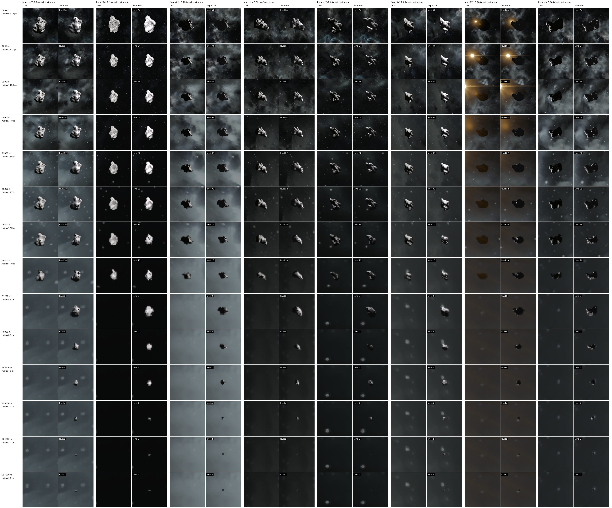
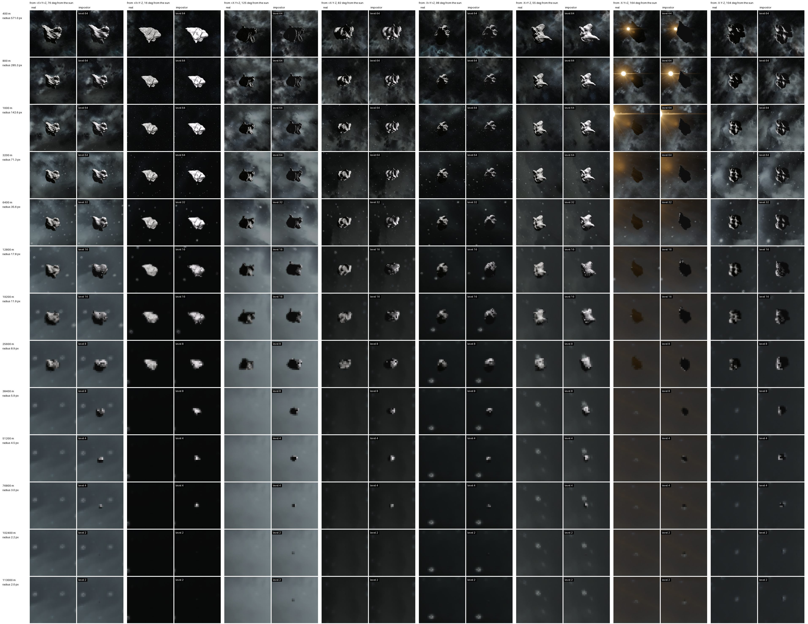
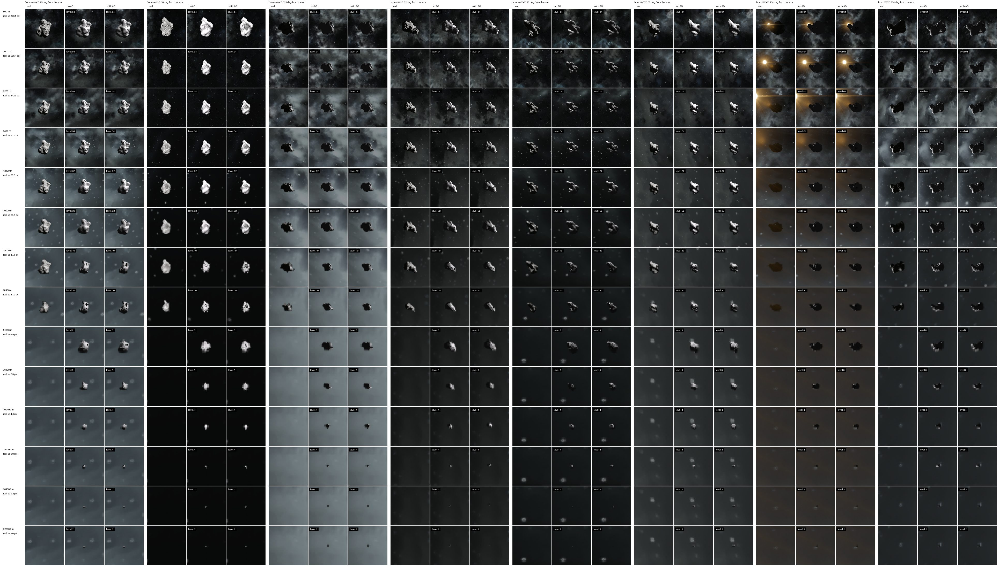
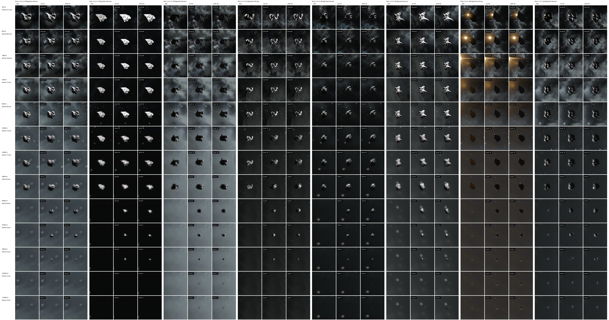

# Asteroid impostors

Saved and edited asteroids beyond the range the game replicates them to. That range is
`ViewDistance/√3` per axis around the player (8.7 km at the default 15 km view distance), so
past it players see no rock where a mined or saved asteroid is.

The two sheets below compare real asteroids with their impostors, ambient occlusion off.
Each row is a distance, from close up to where the default `MinPixels` drops the impostor.
Each column pair is a view from one of the 8 cube corners, with the angle to the sun on top:
the real asteroid on the left, its impostor on the right. The impostor is shot three radii
to the side of the real one, since the game can't hide a real asteroid. Every impostor cell
names its level of detail. Where the real cell is empty, the game no longer draws that
asteroid. Rendered at 2560x1440 with `tests/compare.py`.

**512 m asteroid** (`Asteroid512-008`), 800 m to 227 km. The game stops drawing it past
about 50 km.

**256 m asteroid** (`Asteroid256-011`), 400 m to 113 km. The game stops drawing it past about
30 km.

## What gets one

- Asteroids the clients don't have by themselves: saved ones and the ones somebody edited.
  Procedural asteroids nobody touched are generated by every client within its view distance,
  so they get none. Planets get none either; the game draws them from afar.
- Like grids, only those within `MaxDistance` and at least `MinPixels` across on screen. See
  [Configuration](Configuration.md).

## What it looks like

The server reads the voxel storage at a coarse voxel level of detail and fills one cell per
voxel above the iso level. The color comes from the material's mined ore (stone, iron, ice and
the rest).

- Quads are shaded with a smoothed surface normal, the gradient of the blurred occupancy.
  Shaded by their faces alone, the voxel stairs would turn an asteroid seen along an axis into
  one flat color.
- Small impostors are dimmed by the mod, down to 0.82 times as bright under 13 pixels in
  radius on a 1080p screen: real asteroids look darker than their lit impostors at that size.
- `AsteroidOcclusion` (on by default) bakes ambient occlusion into the colors, which darkens
  pits and crevices. Against the real asteroids it helped at some distances and hurt at
  others, and it doubles the build time.

The same asteroids with three columns per direction: the real asteroid, the impostor without
ambient occlusion and the impostor with it.

**512 m asteroid**, 800 m to 227 km:

**256 m asteroid**, 400 m to 113 km:

## Levels of detail

| Level | Quads, 512 m | Quads, 256 m | Built from |
|---|---|---|---|
| 64 | 14858 | 14555 | voxels |
| 32 | 3635 | 3416 | voxels |
| 16 | 513 | 796 | voxels |
| 8 | 192 | 170 | voxels two levels finer, pooled |
| 4 | 38 | 38 | level 8 |
| 2 | 6 | 6 | level 8 |

Each quad is 10 bytes, so level 64 is about 150 KB. The server sends one level per impostor
and player, about one cell per 2.5 pixels of the impostor's size on a 1080p screen.

- Level 8 pools voxels two levels finer: a cell is filled when at least half of its voxels
  are. The game's own coarse voxels erode thin parts, and level 8 looked half as large as
  level 16 when read directly. A rock that is small for its voxel storage gets at least 6
  cells across.
- Levels 4 and 2 are downsampled from 8, a cell filled when half of its 8 children are, or
  any of them if the rock would vanish. They are for the far ones that cover a few pixels:
  an asteroid ring shows hundreds at once, and level 16 costs 15 times the quads of level 8.

## Rebuilds

Mining, a blast or any other storage edit rebuilds the impostor, at most every
`RebuildSeconds` (60). Asteroids don't move, so they need no state updates.

More detail: [Design](Design.md#asteroids-se-383).
