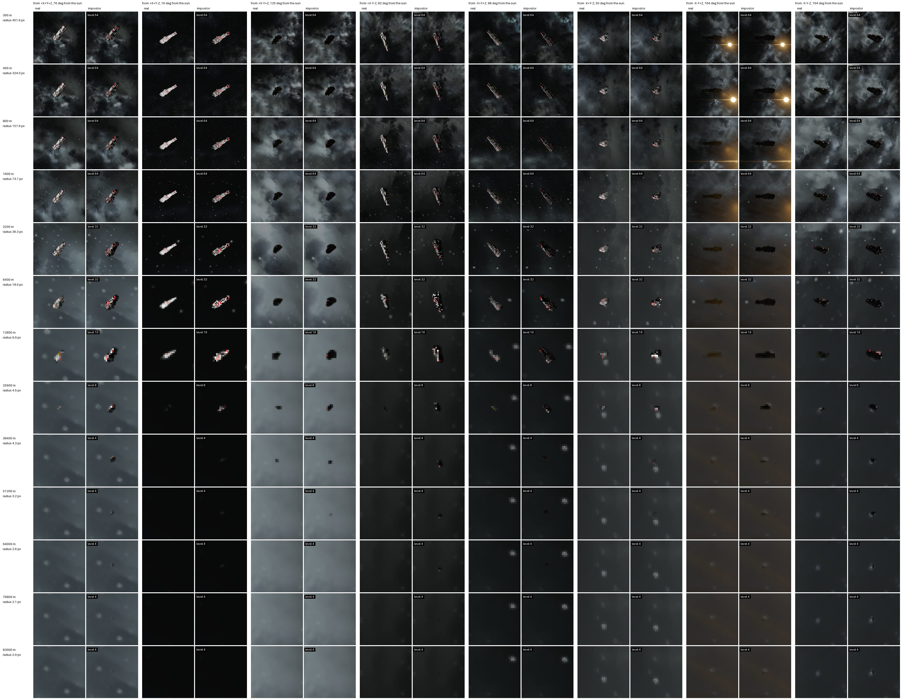

# Grid impostors

Ships and stations beyond the sync distance, which the server doesn't replicate to the
players. Without impostors those players see empty space there.

*IMDC Rhea v2.3 (18.6k blocks, 40 grids). Each row is a distance; each column pair is a view
from one cube corner, the real ship on the left and its impostor on the right. Every impostor
cell names its level of detail. Past 20 km, the largest sync distance the game allows, the
real column is empty, as it is in the game without impostors. The last row is where the
default `MinPixels` drops the impostor. Rendered at 2560x1440 with `tests/compare.py`.*

## What gets one

- One impostor per physical grid group, so docked ships and subgrids show as one. Its frame
  and id are those of the group's largest grid.
- Groups with fewer than `MinBlocks` blocks (8) get none, nor do projections and previews.
- Only groups outside the player's replication range, within `MaxDistance` (the view distance
  by default) and at least `MinPixels` across on screen. The largest `MaxImpostorsPerPlayer`
  win. See [Configuration](Configuration.md).
- The impostor arrives `ReplicationMargin` (500 m) inside the sync distance, so there is no
  gap when the real grid leaves. While the real grid is on the client, the mod doesn't draw
  the impostor.

## What it looks like

The server turns the blocks into a grid of cells, each filled or empty with an average color,
and merges the outside faces into flat colored quads. The mod draws them as billboards shaded
by the sun.

- Every block takes its paint color; windows are dark.
- The cells are a whole number of the main grid's blocks and sit on its block lattice, so the
  finest level shows the main grid block for block.
- Every block is a full cube: sloped armor comes out as stairs. Faces of cells made mostly of
  Slope, Corner and Round blocks are shaded with a smoothed surface normal, so the stairs don't
  alternate between lit and dark steps.
- Subgrids are frozen at their pose of the last build.
- Small impostors are brightened by the mod, up to 1.35 times under 13 pixels in radius on a
  1080p screen: real grids carry more light than their impostors at that size.

## Levels of detail

| Level | Rhea quads | Shape bytes | Built from |
|---|---|---|---|
| 64 | 4355 | 43.6 KB | blocks |
| 32 | 860 | 8.6 KB | blocks |
| 16 | 272 | 2.7 KB | blocks |
| 8 | 79 | 0.8 KB | level 16 |
| 4 | 26 | 0.3 KB | level 16 |

The server sends one level per impostor and player, about one cell per 2.5 pixels of the
impostor's size on a 1080p screen. Grids keep level 16 down to half the size where other
impostors switch, since their coarser levels lose the shape fast. Levels under 16 are
downsampled from 16: a cell is filled when 2 of its 8 children are, with their average color.

A zoomed view, like the rifle's iron sight or a camera or telescope mod, shows impostors
larger than that estimate. The mod tells the server, which sends finer levels for the
impostors inside the view within a fraction of a second and lets them stay for 30 seconds
after the zoom. See [Design](Design.md), "Zoomed views".

## Rebuilds

A group is rebuilt when blocks are added or removed or its bounds change, at most every
`RebuildSeconds` (60). Paint doesn't change that signature, so impostors in view are also
rebuilt every `RefreshSeconds` (600). Only groups some player is looking at are built.

More detail: [Design](Design.md#grids-se-382).
