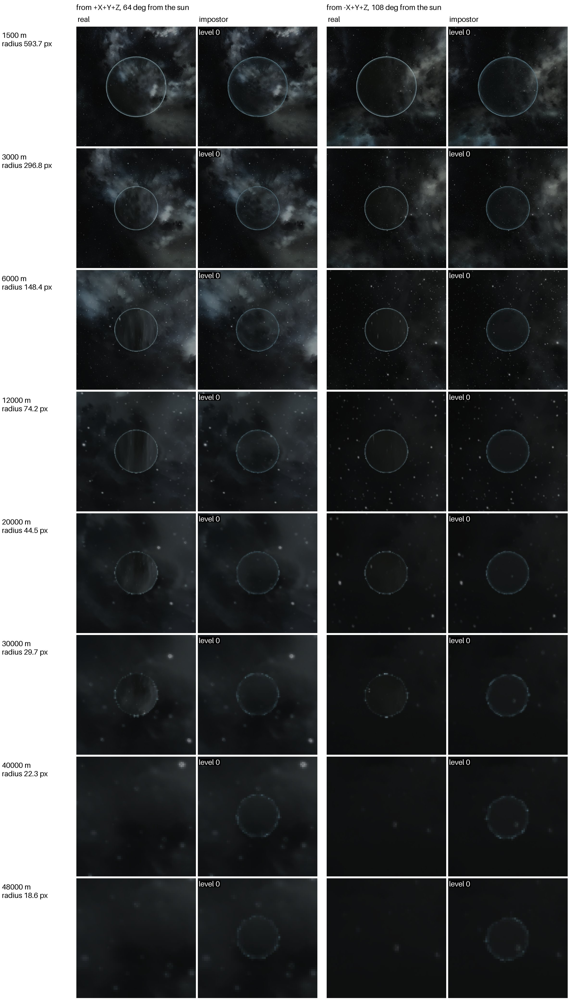
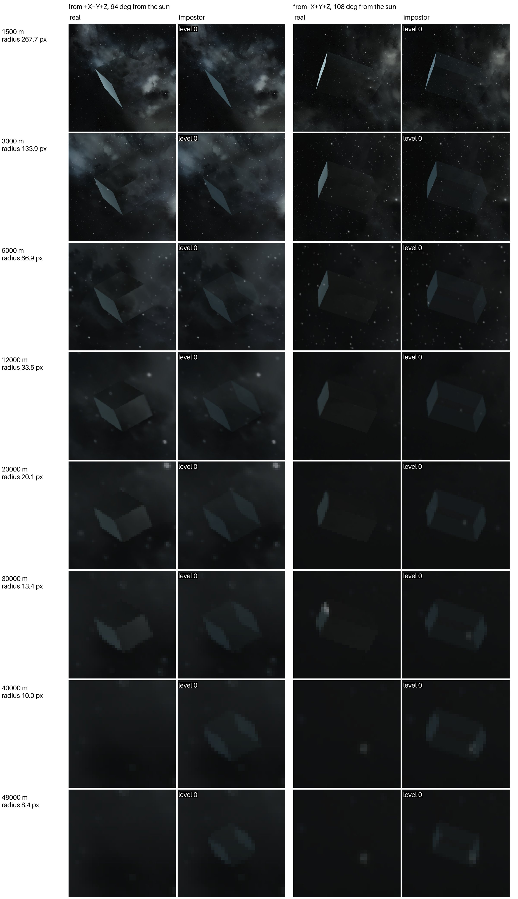

# Safe zone impostors

Safe zones beyond the sync distance, which the server doesn't replicate to the players.
Without impostors players can't see where the protected areas are until they are within a
few kilometers. With them, every enabled zone shows out to the view distance as a translucent
bubble of its shape, size and color. The game's shield pattern is not copied: from afar the
outline and the size are what count, and a larger zone stands out more.

The sheets below compare real zones with their impostors. Each row is a distance; each column
pair is a view from one direction, the real zone on the left and its impostor on the right.
The mod's debug compare mode hides the real zone for the impostor shot. Where the real cell is
empty, the game no longer draws the zone: past about 30 km for both. The radius in the row label
is that of the zone's bounding box, about 1.7 times a sphere's own. Rendered at 2560x1440 with `tests/compare.py`.

**Sphere, 500 m radius** (`safezone:500`), 1.5 to 48 km: 512 quads out to 20 km, 128 from
30 km.

**Box, 600 x 300 x 400 m** (`safezone:600,300,400`), 1.5 to 48 km, 6 quads.

## What gets one

- Every enabled safe zone: admin zones and the zones of safe zone blocks. A disabled zone
  protects nothing, so it gets none.
- Only zones outside the player's replication range, within `MaxDistance` and at least
  `MinPixels` across on screen, like grids. Zones go first among the player's
  `MaxImpostorsPerPlayer`.
- `SafeZones` in [Configuration](Configuration.md) turns them off.

## What it looks like

The server sends the zone itself, not a cell grid: sphere or box, its size and its color, 17
bytes. The mod draws a shell of flat quads, nearly clear seen face on and denser and paler
where the line of sight grazes the surface, so a sphere shows as a thin rim and a box shows
its edge-on faces, as the game's shield does.

| Zone | Radius on screen | Quads |
|---|---|---:|
| Box | any | 6 |
| Sphere | under 6 px | 32 (8 x 4) |
| Sphere | 6 to 25 px | 128 (16 x 8) |
| Sphere | over 25 px | 512 (32 x 16) |

Each size keeps the outline within about half a pixel of a circle. On a 1080p screen a 500 m
sphere is over 25 px in radius out to about 15 km, under 6 px past about 64 km. All the quads
count against `MaxQuadsPerFrame`, since both halves of the shell are drawn.

## Small impostors in or behind a zone

The game draws a zone's surface with a distorting shield effect. Impostors are drawn on top
of it, undistorted, and the small ones there look like noise. So an impostor whose line of
sight from the player passes through an enabled zone, or ends inside one, needs
`SafeZoneMinPixels` (8 by default) instead of `MinPixels` (3). Zones themselves keep
`MinPixels`. A player inside a zone sees everything through its surface, so then the stricter
cut-off applies to all impostors.

`tests/scenario.py` checks it with three grids 27 m in radius, 3 to 8 pixels across from
where the player waits: one inside a 500 m zone and one behind it are cut off, one as far
away with nothing in between is shown. Closer to the zone, at 10 pixels, the one inside shows
again.

## Clusters

Admin zones are on every node, so each node shows them itself. The zone of a safe zone block
travels with the block's grid between nodes, and nodes report it to the World Authority like
a grid, so players on other nodes see it too.

## Build times

A safe zone has nothing to build: snapshot and build take about a millisecond together on
polaris (AMD Ryzen 9 5950X) and under 0.1 ms on sirius (AMD Ryzen 7 9800X3D), from the
`Impostor build:` lines of the comparison and scenario runs (`tests/build_times.py`).

| Machine | Zone | Snapshot ms | Build wall ms | Build CPU ms |
|---|---|---:|---:|---:|
| polaris, Ryzen 9 5950X | sphere, 500 m | 0.4 | 1.1 | 0.8 |
| polaris, Ryzen 9 5950X | box, 600 x 300 x 400 m | 0.5 | 1.2 | 0.8 |
| sirius, Ryzen 7 9800X3D | sphere, 500 m | 0.0 | 0.0 | 0.0 |
| sirius, Ryzen 7 9800X3D | box, 600 x 300 x 400 m | 0.0 | 0.0 | 0.0 |
