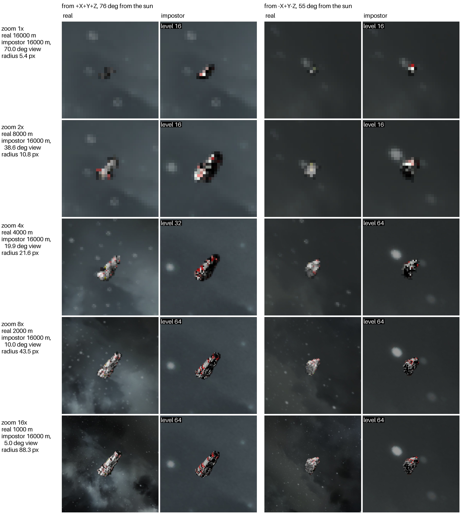
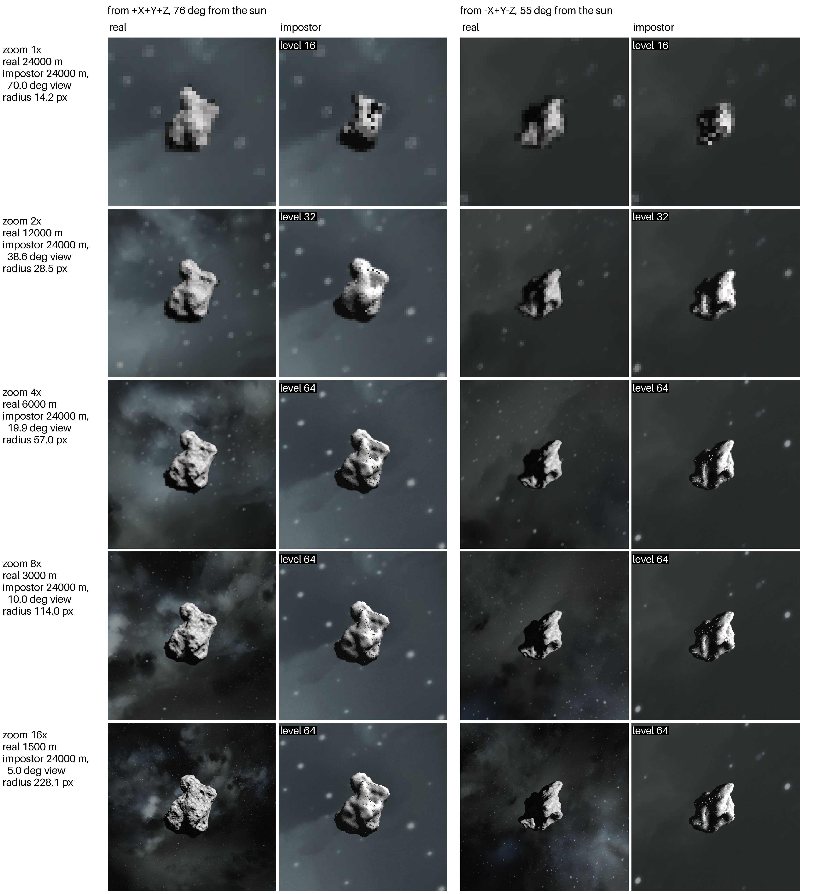

# Zoomed views

The server picks each impostor's level of detail from its size on a 1080p screen with a 70°
field of view. A rifle's iron sight, a camera or telescope mod or a spectator zoom shows the
far impostors several times larger than that, and a level picked for the normal view would
look blocky there. So the mod tells the server about a zoomed view, and the impostors inside
it get the finer levels the zoom needs.

## Real and impostor through a zoom

Each row is one zoom factor. On the left is the real object seen from closer by the same
factor with the normal 70° view; on the right is its impostor from the far distance through
the zoomed view. Both are the same size on screen, so the impostor should show about as much
detail as the real object does. Every impostor cell names the level the server sent for that
zoom. Rendered at 1920x1080 with `tests/compare.py` (`IMP_ZOOMS`).

**IMDC Rhea v2.3** from 16 km, zoomed up to 16 times (a 5° view):

**512 m asteroid** (`Asteroid512-008`, ambient occlusion on) from 24 km, zoomed up to 16
times:

Level 64 is the finest there is, so zooms beyond about 4 times show no more detail.

## How it works

- The mod reads the camera's field of view with zoom (`FovWithZoom`) and the screen size.
  While the view shows things at least 1.5 times larger than the server's estimate, it sends
  a small `View` message: when the zoom starts, when it changes by 5%, when the view turns
  by an eighth of its field of view, and once more when the zoom ends. It checks every 10
  ticks. Players with only the mod get this too, no plugin needed.
- The server multiplies the size of the impostors inside the view by the zoom, 32 times at
  most. They sort first, so they get the shape credit (`ShapeBytesPerSecond`) before the
  others, and the server picks that player's impostors again within 10 ticks instead of at
  the next full second.
- A zoomed level is used only while its shape has at most `MaxQuadsPerFrame` quads, so one
  impostor can't take the client's whole quad budget, and all the levels together fit it.
- When the zoom ends the server puts the normal level back. The client keeps every shape it
  got in its shape store, so looking through the zoom again costs a state only. (Until
  SE-671 the zoomed level stayed for 30 seconds instead, and over an asteroid ring the near
  rocks kept so many quads that a wide view after a zoom dropped most of the others.)
- The server's cone is a quarter of the field of view wider than the view, so what a turn
  brings in is mostly there already. The client draws only what is inside its own view.
- A client with the world's asteroid pack picks the asteroids' levels itself and sizes those
  in its view for the zoom the same way, without the server (see
  [Design](Design.md#client-picked-levels-se-971)).

How fast: `tests/zoom.py` aims down the rifle's iron sight (70° to 40°) at a 512 m asteroid
13 km away, and level 64 arrives 0.05 seconds after the zoom starts. A shape larger than the
shape credit left can wait a second or two behind the ones sent just before it, see the
settle times in the test output.

More detail: [Design](Design.md), "Zoomed views" and "Moving views".
